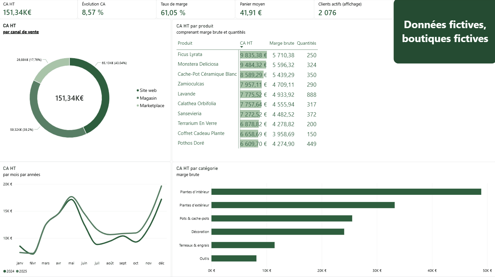
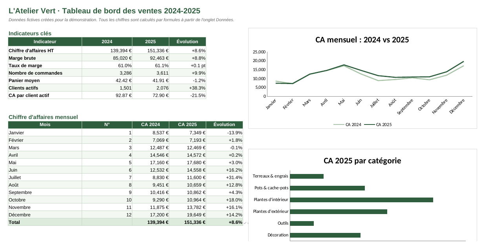

# 01 · Tableau de bord des ventes (Excel / Power BI)



*Version Power BI, ci-dessus, et version Excel, ci-dessous.*



**Objectif** : donner au gérant de L'Atelier Vert (boutique fictive) une vue claire de son activité 2024-2025 en un seul écran.

## Fichiers

- `ventes_fictives.pbix` : rapport Power BI (à ouvrir avec Power BI Desktop)
- `tableau_de_bord_ventes_atelier_vert.xlsx` : version Excel

## Contenu du classeur `tableau_de_bord_ventes_atelier_vert.xlsx`

| Onglet | Rôle |
|---|---|
| **Tableau de bord** | Indicateurs clés 2024 vs 2025, CA mensuel, catégories, canaux, top 10 produits, régions, 4 graphiques |
| **Données** | 12 500 lignes de ventes avec colonnes calculées (CA, coût, marge, compteurs) |
| **Produits** | Référentiel de 28 produits avec CA, quantités, marge et rang 2025 |
| **Notes** | Documentation des formules et mode de mise à jour |

Tous les chiffres sont **calculés par formules** (SUMIFS, INDEX/MATCH, RANK). Changer les années en C6 et D6 met à jour l'ensemble du tableau. Une cellule de contrôle vérifie que le total mensuel correspond au CA annuel.

## Ce que montre le tableau

- CA en hausse de **+8,6 %** et taux de marge stable autour de **61 %**.
- Le nombre de clients actifs augmente beaucoup plus vite que le CA (+38 %) : la croissance vient du recrutement, et le CA par client baisse.
- Deux pics saisonniers : **avril-mai** et **décembre**.
- Le site web est le premier canal de vente : 43 % du CA en 2025, en hausse de 11 %.

## Version Power BI : mesures DAX

Le même tableau de bord se reproduit dans Power BI en important `data/ventes_atelier_vert_2024_2025.csv` (table `Ventes`) et en créant une table de dates.

```DAX
CA HT = SUM ( Ventes[CA_HT] )

Marge brute = SUM ( Ventes[Marge] )

Taux de marge = DIVIDE ( [Marge brute], [CA HT] )

Nb commandes = DISTINCTCOUNT ( Ventes[ID_Commande] )

Panier moyen = DIVIDE ( [CA HT], [Nb commandes] )

Clients actifs = DISTINCTCOUNT ( Ventes[ID_Client] )

CA N-1 = CALCULATE ( [CA HT], SAMEPERIODLASTYEAR ( 'Calendrier'[Date] ) )

Évolution CA = DIVIDE ( [CA HT] - [CA N-1], [CA N-1] )

Part du CA =
DIVIDE ( [CA HT], CALCULATE ( [CA HT], ALLSELECTED ( Ventes[Catégorie] ) ) )

Rang produit =
RANKX ( ALL ( Ventes[Produit] ), [CA HT], , DESC, DENSE )
```

Table de dates à créer (Modélisation > Nouvelle table), puis à relier à `Ventes[Date]` :

```DAX
Calendrier =
ADDCOLUMNS (
    CALENDAR ( DATE ( 2024, 1, 1 ), DATE ( 2025, 12, 31 ) ),
    "Année", YEAR ( [Date] ),
    "Mois n°", MONTH ( [Date] ),
    "Mois", FORMAT ( [Date], "mmm" )
)
```

*Données fictives, à titre de démonstration.*
