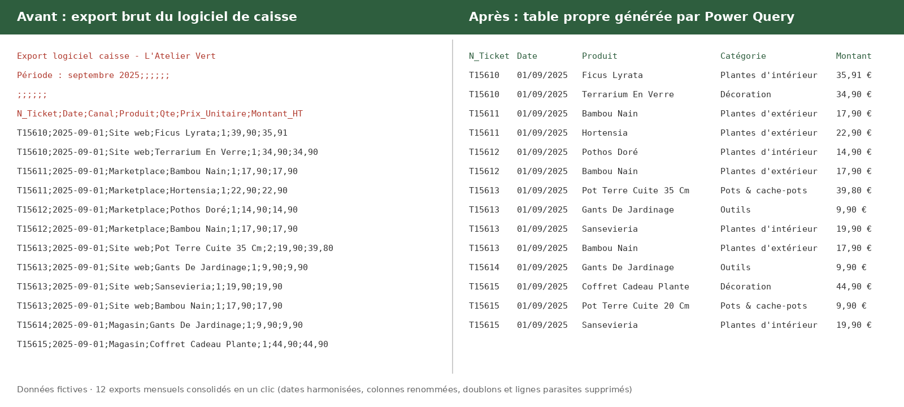

# 02 · Automatisation Power Query : consolider 12 exports désordonnés

**Le problème (fictif mais très courant)** : chaque mois, le logiciel de caisse de L'Atelier Vert produit un fichier CSV. Pour faire le bilan annuel, quelqu'un copie-colle les 12 fichiers à la main et corrige les erreurs une par une, ce qui lui prend plusieurs heures et provoque des oublis.

**La solution** : une requête Power Query qui lit tout le dossier, nettoie chaque fichier et produit une table propre en un clic sur « Actualiser ». Ajouter le fichier du mois suivant suffit pour mettre à jour le tableau.

## Ce que la requête corrige automatiquement

| Défaut dans les exports | Traitement |
|---|---|
| 3 lignes de titre avant les en-têtes | Suppression des lignes, puis promotion des en-têtes |
| Colonnes renommées depuis septembre (`Qte`, `Montant_HT`) | Harmonisation des noms |
| Dates `31/03/2025` jusqu'en juin, `2025-07-15` ensuite | Conversion selon le format détecté |
| Nombres avec virgule décimale | Conversion avec la culture `fr-FR` |
| Noms de produits en MAJUSCULES certains mois, espaces en trop | Clé normalisée + rapprochement avec le référentiel |
| Mai et octobre exportés en double (25 lignes) | Suppression des doublons |
| Lignes vides et ligne `TOTAL` en bas de fichier | Filtrage |
| Catégorie absente des exports | Récupérée par fusion avec `reference_produits.csv` |

## Fichiers

| Fichier | Rôle |
|---|---|
| `exports_caisse/` | Les 12 exports bruts (2025) |
| `reference_produits.csv` | Référentiel des produits (ID, nom, catégorie) |
| `requetes_power_query.m` | Code M complet et commenté |
| `resultat_attendu.csv` | Table propre attendue, pour vérifier son résultat : **6 536 lignes, 151 334,88 € de CA** |

## Reproduire dans Excel (environ 10 minutes)

1. **Données > Obtenir des données > Lancer l'éditeur Power Query.**
2. **Accueil > Gérer les paramètres > Nouveau paramètre** : crée `DossierExports` (chemin du dossier `exports_caisse`) et `CheminReferentiel` (chemin de `reference_produits.csv`), de type Texte.
3. **Accueil > Nouvelle source > Autres sources > Requête vide**, puis **Éditeur avancé** : colle le bloc « Référentiel produits » de `requetes_power_query.m` et renomme la requête exactement ainsi.
4. Même chose pour la fonction `fxNettoyerExport`, puis pour la requête principale `Ventes 2025`.
5. **Fermer et charger** : la table propre arrive dans une feuille Excel.

> La conversion des dates utilise la syntaxe `Date.FromText(texte, [Format = ..., Culture = ...])`, disponible dans Excel 365 et 2021. Sur une version plus ancienne, remplace-la par `Date.FromText(texte, "fr-FR")`.

## Avant / après



**Avant** (extrait d'un export) :
```
Export logiciel caisse - L'Atelier Vert
Période : septembre 2025;;;;;;
;;;;;;
N_Ticket;Date;Canal;Produit;Qte;Prix_Unitaire;Montant_HT
T15610;2025-09-01;Site web;Ficus Lyrata;1;39,90;35,91
```

**Après** : une seule table typée avec `N_Ticket | Date | Canal | ID_Produit | Produit | Catégorie | Quantité | Prix_Unitaire | Montant`.

*Données fictives, à titre de démonstration.*
