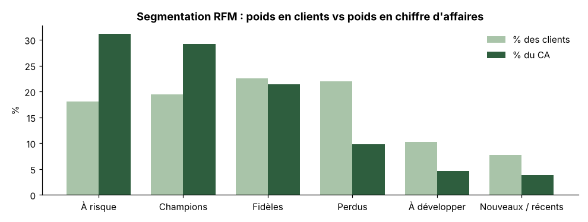
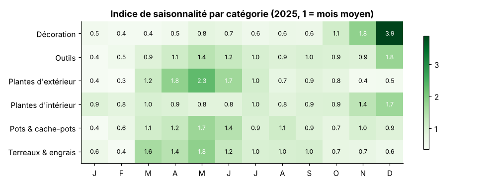
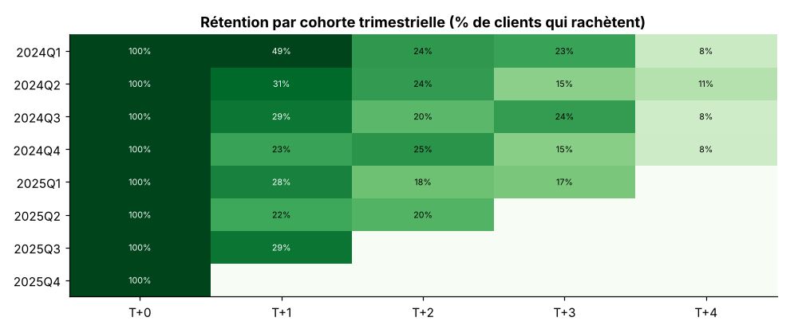

# 03 · Analyse des ventes et des clients en Python

Notebook : [`analyse_ventes_clients.ipynb`](analyse_ventes_clients.ipynb) (pandas, matplotlib)

## Questions traitées et principaux résultats

| Analyse | Résultat clé |
|---|---|
| Indicateurs 2024 vs 2025 | CA +8,6 %, mais CA par client en baisse : la croissance vient du recrutement |
| Saisonnalité par catégorie | Pic d'avril-mai pour l'extérieur et les terreaux, décembre pour la décoration (×3,9) |
| Pareto des produits | 18 produits sur 28 font 80 % du CA : catalogue équilibré |
| Segmentation RFM | Clients « À risque » : 18 % des clients mais 31 % du CA, cible prioritaire de relance |
| Cohortes trimestrielles | Environ 30 % des nouveaux clients rachètent le trimestre suivant |





## Lancer le notebook

```bash
pip install pandas matplotlib jupyter
jupyter notebook analyse_ventes_clients.ipynb
```

Le notebook lit `../data/ventes_atelier_vert_2024_2025.csv`.

*Données fictives, à titre de démonstration.*
