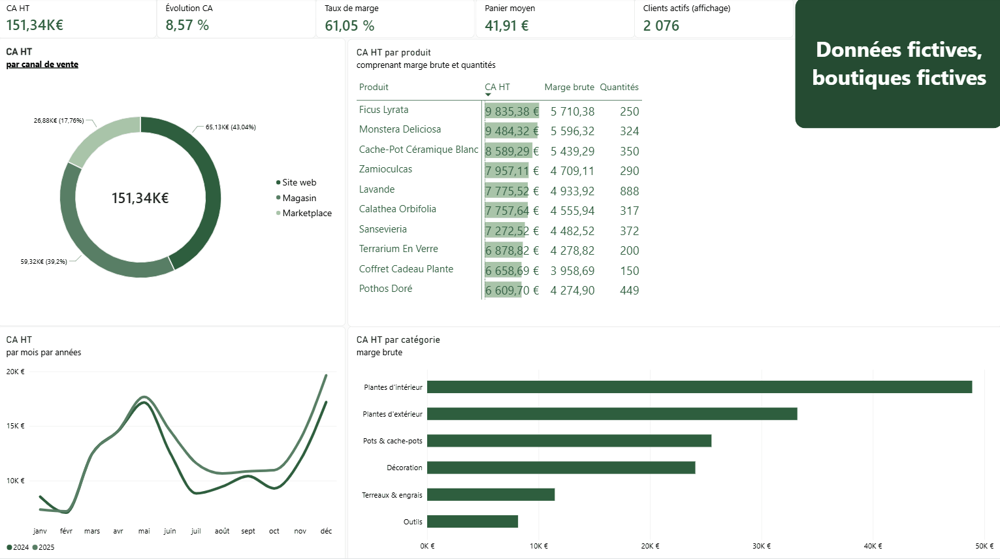

# Portfolio data : L'Atelier Vert (données fictives)

Trois projets de démonstration construits autour d'une même entreprise imaginaire, **L'Atelier Vert**, une boutique de plantes qui vend en magasin, sur son site web et sur une marketplace.

> Toutes les données sont **fictives**, générées par le script `data/generer_donnees.py`. Aucune donnée réelle d'entreprise ou de client n'est utilisée.

| Projet | Compétences | Contenu |
|---|---|---|
| [01 · Tableau de bord des ventes](01_tableau_de_bord_ventes/) | Excel, SUMIFS, INDEX/MATCH, graphiques, DAX | Classeur Excel interactif + mesures pour la version Power BI |
| [02 · Automatisation Power Query](02_automatisation_power_query/) | Power Query (langage M), nettoyage de données | 12 exports de caisse désordonnés consolidés automatiquement |
| [03 · Analyse clients en Python](03_analyse_python/) | Python, pandas, matplotlib, segmentation RFM, cohortes | Notebook commenté avec recommandations |

## Les données

`data/` contient 12 500 lignes de ventes sur 2024-2025 (environ 6 900 commandes et 3 150 clients), avec :
- une saisonnalité réaliste (pic de printemps pour l'extérieur, pic de décembre pour la décoration) ;
- trois canaux de vente, 28 produits répartis en 6 catégories et 13 régions ;
- des remises (soldes, promotions web, fidélité).

| Fichier | Description |
|---|---|
| `ventes_atelier_vert_2024_2025.csv` | Une ligne par produit vendu (séparateur `;`, décimales `,`) |
| `produits.csv` | Référentiel produits (prix, coût, catégorie) |
| `clients.csv` | Clients (région, date de première commande) |
